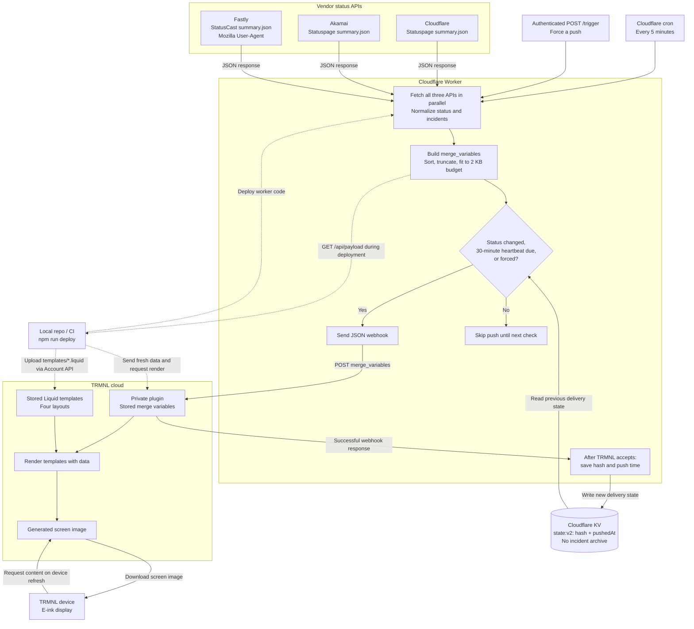

# CDN Status TRMNL Plugin

A Cloudflare Worker that powers a [TRMNL](https://usetrmnl.com/) private plugin showing live status for:

- **Cloudflare** - Statuspage JSON API
- **Akamai** - Statuspage JSON API
- **Fastly** - StatusCast JSON summary API

## How it works



Solid arrows show the scheduled data flow; dotted arrows show deployment. The worker initiates requests to each vendor API. **TRMNL renders the screen in its cloud; the device downloads the resulting image.** Its refresh schedule is separate from the worker's five-minute checks.

KV is used only to decide when to push. A failed webhook leaves the previous state intact so the next run retries. Deployment sends fresh data through the TRMNL Account API directly and does not update the worker's KV delivery state.

- The worker pushes **data, not HTML**. `npm run deploy` deploys the worker and uploads the Liquid templates to TRMNL, keeping each webhook under the configured 2kb budget.
- A push happens when the displayed status **changes**, or as a **heartbeat** every `HEARTBEAT_MINUTES` (default 30) so the footer time and the "2h ago" ages stay current.
- State is saved to KV **only after TRMNL accepts the push**, so failed pushes retry on the next run.
- Templates exist for every TRMNL layout: `full`, `half_horizontal`, `half_vertical`, `quadrant` (mashups work).

### What is shown

| Provider | Items |
|---|---|
| Cloudflare / Akamai | Unresolved incidents (with status: investigating, monitoring, …), in-progress maintenance, and non-operational components grouped by status, e.g. `Major outage · 22 components` with PoP codes `OKC, MEX, …` |
| Fastly | Unresolved incidents and active maintenance from the JSON summary, including long-running events; severity comes from structured component status. Future events are excluded. |

Items are sorted by severity, then recency. Columns show as many whole items as fit, and the header shows the total (`5 active`).

Fastly uses `https://www.fastlystatus.com/summary.json`, a [documented StatusCast endpoint](https://support.statuscast.com/docs/statuscast-endpoints). Requests use a Mozilla browser User-Agent: on November 3, 2026, a custom or absent User-Agent returned HTTP 403 while the browser User-Agent returned JSON without authentication. This header requirement is observed behavior, not a documented API guarantee. Cloudflare and Akamai retain the application's normal User-Agent.

Fastly's page status comes from `Status` / `StatusText`. Incident lifecycle and severity use `Status`, `IncidentType`, and the latest published post's `NewComponentStatus`; HTML post bodies are converted to plain text only for descriptions. Dates without a zone are interpreted as UTC. There is no age cutoff and no RSS fallback. HTTP errors, non-JSON responses, or unexpected summary fields produce **Status unavailable**, rather than an operational status. KV still stores delivery state only, not an incident archive.

## Setup

Requires Node 22+ (`nvm use`).

```bash
npm ci
cp wrangler.toml.example wrangler.toml       # local deployment config, ignored by git
cp .env.example .env.local                  # local credentials and deployment URLs
npx wrangler login
npx wrangler whoami                            # choose your Cloudflare account
npx wrangler kv namespace create CDN_STATUS_KV   # put the id in wrangler.toml
npx wrangler secret put TRMNL_PLUGIN_UUID        # from the TRMNL private plugin
npx wrangler secret put TRIGGER_TOKEN            # optional, enables POST /trigger
# Set your worker name in wrangler.toml and configure .env.local as described below.
npm run deploy
```

### TRMNL

1. Use your existing private plugin, or create one with strategy **Webhook**. Its UUID must match the worker's `TRMNL_PLUGIN_UUID` secret.
2. Create an [account API key](https://trmnl.com/account/developer/edit) with **Read** and **Content** capabilities, restricted to this plugin. This is separate from the webhook UUID and device API key.
3. Copy `.env.example` to `.env.local` (ignored by git). Set `TRMNL_API_KEY`, `TRMNL_PLUGIN_SETTING_ID` (numeric settings ID from the plugin URL, or its UUID), and `TRMNL_WORKER_URL` (your worker's production URL). Set `CLOUDFLARE_ACCOUNT_ID` to your own account ID when needed. No production account or worker URL is supplied by this repository. Environment variables take precedence over `.env.local`.
4. Run `npm run deploy`. It reads and backs up the existing four layouts, deploys the worker, uploads and reads back each template, sends the deployed worker's current payload, and requests a screen render. Devices pick up the result on their next scheduled refresh.

```bash
npm run deploy -- --dry-run # validate local templates; no network calls or credential check
npm run deploy             # worker + all templates + fresh data + render request
npm run deploy:templates   # templates + fresh data from the existing worker + render request
npm run deploy:worker      # only the worker (uses Wrangler's normal environment/config)
```

The combined deployment loads `.env.local` before running Wrangler, so its `CLOUDFLARE_ACCOUNT_ID` selects the correct account. Standalone Wrangler commands, including login/setup commands and `deploy:worker`, use Wrangler's normal configuration; if you belong to multiple accounts, export your `CLOUDFLARE_ACCOUNT_ID` in the shell first. On a first deployment, run `npm run deploy:worker` to obtain your worker URL, set it in `.env.local`, then run `npm run deploy:templates`.

`wrangler.toml.example` is the tracked configuration template. Copy it to the ignored `wrangler.toml`, choose your worker name, and replace `YOUR_KV_NAMESPACE_ID` with the namespace ID from your account. Keep account IDs, real deployment URLs and credentials in these ignored local files or CI configuration. Do not force-add them to git.

To reuse credentials from `~/.secrets`, set `TRMNL_SECRETS_FILE=~/.secrets` in `.env.local` instead of copying the key and plugin ID. The deploy script reads only `TRMNL_API_KEY` and `TRMNL_PLUGIN_SETTING_ID` from that file, accepting dotenv assignments with optional `export`. It does not execute shell commands or expand shell expressions. Nonempty values already supplied in the environment or `.env.local` take precedence.

Deployment credentials stay on your computer or in CI; the account API key is not uploaded to the worker. Existing markup backups are stored in `.wrangler/trmnl-backups/` (ignored by git). Uploads are sequential and stop on failure; deployment is not atomic across Cloudflare and TRMNL. Earlier successful steps remain live. After fixing an error, rerun the command, or restore individual layouts from the backup via **Edit Markup**. The Shared tab and other plugin settings are untouched. The script requests a render but does not wait for a physical device to display it.

The API contract is documented in TRMNL's [OpenAPI specification](https://trmnl.com/api-docs): `PUT /api/plugin_settings/{id}/markup/{size}`, `POST /api/plugin_settings/{id}/data`, and `POST /api/plugin_settings/{id}/refreshes`.

Manual setup is also possible: paste `templates/*.liquid` into the matching **Edit Markup** tabs, or retrieve them from `https://<worker>/templates/{layout}.liquid`. Then click **Force Refresh** in TRMNL.

## Configuration (`wrangler.toml` `[vars]`)

| Variable | Default | Purpose |
|---|---|---|
| `TIMEZONE` | `UTC` (repo sets `America/Chicago`) | IANA timezone for the footer "Checked" time |
| `HEARTBEAT_MINUTES` | `30` | Maximum time between pushes |
| `TRMNL_MAX_PAYLOAD_BYTES` | `2000` | Webhook body budget; raise to `5000` on TRMNL+ |

## Endpoints

| Endpoint | Description |
|---|---|
| `GET /` | Health check |
| `GET /api/status` | Normalised status snapshot (live) |
| `GET /api/payload` | Exact `merge_variables` that would be pushed, plus byte size |
| `GET /preview[?layout=full]` | Renders the real templates with TRMNL's CSS (all layouts by default) |
| `GET /templates/{layout}.liquid` | Raw template for pasting into TRMNL |
| `POST /trigger` | Force a push. Requires `Authorization: Bearer $TRIGGER_TOKEN`; disabled if unset |

```bash
curl -X POST -H "Authorization: Bearer $TRIGGER_TOKEN" https://<worker>/trigger
```

## Development

```bash
npm test        # node:test suite (parsers, payload budget, push logic, templates, auth)
npm run dev     # wrangler dev; curl "http://localhost:8787/__scheduled" to run the cron
npm run build   # bundle check without deploying
```

> Behind a corporate HTTPS proxy, `wrangler dev` (workerd) cannot reach the status pages and every provider shows "Status unavailable". Deployed workers are unaffected.

## Layout

```
src/
  index.js              routes + cron handler
  sources/              status page fetchers and pure parsers
  payload.js            merge_variables builder, byte budget, change hash
  trmnl.js              webhook push + change/heartbeat decision
  preview.js            renders templates with liquidjs for /preview
  auth.js               bearer token check
templates/*.liquid      TRMNL markup, one per layout
scripts/deploy.js       worker + template deployment through the TRMNL Account API
test/                   node:test suites
```
